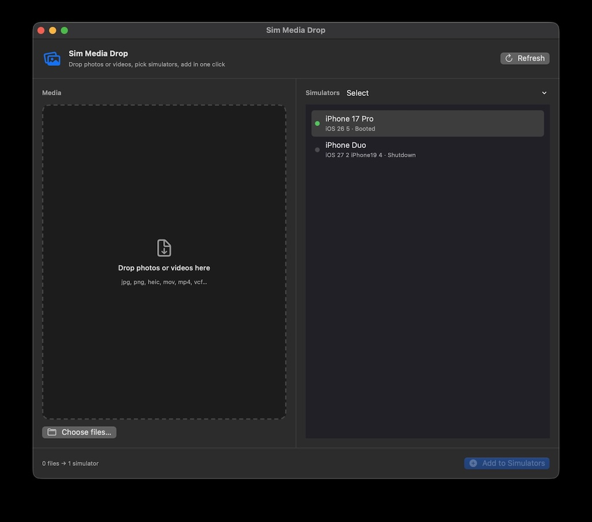

# Simulator Media Drop

So here is macOS app to add photos, videos, and contacts to iOS Simulators with drag & drop.

Handy when Simulator can’t import media from the UI (common on newer iOS runtimes) and you don’t want to keep running:

```bash
xcrun simctl addmedia booted ~/Desktop/photo.jpg
```

<p align="center">
  
</p>

## How to use

1. Boot the simulator(s) you care about in Xcode / Simulator.
2. Open **Sim Media Drop**.
3. Drop media into the left panel (or click **Choose files…**).
4. Select one or more simulators on the right  
   (booted simulators are selected automatically).
5. Click **Add to Simulators** (or press **⌘↩**).

Supported files: photos (`jpg`, `png`, `heic`, …), videos (`mov`, `mp4`, …), and contacts (`vcf`).

Tips:

- Use **Select → Booted only** if you only want running simulators.
- Click **Refresh** after you boot or shut down a simulator.
- You can add the same files to several simulators in one go.

## Requirements

- macOS 14+
- Xcode (needs `xcrun simctl`)

## Build

```bash
git clone https://github.com/<you>/SimMediaDrop.git
cd SimMediaDrop
./Scripts/build-app.sh
open dist/SimMediaDrop.app
```

Optional: copy it into Applications:

```bash
cp -R dist/SimMediaDrop.app /Applications/
```

Or open `Package.swift` in Xcode and run the **SimMediaDrop** scheme.

## License

MIT
